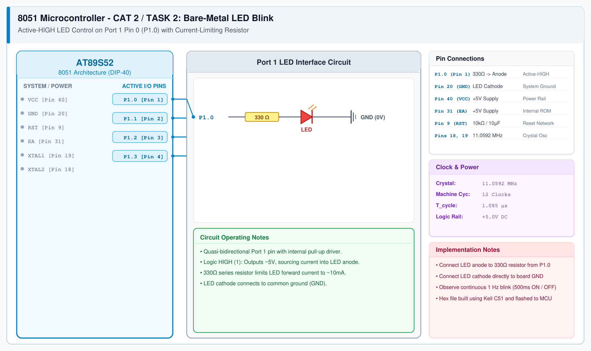

# EXPERIMENT DETAILS

**EXP:** CONTINUOUS ASSESSMENT 2

**DATE:** 04/08/2026

**NAME OF EXP:** Bare-Metal GPIO Control - External LED Flasher

**HARDWARE SETUP / PLATFORM:** AT89S52 Microcontroller, 5mm High-Efficiency LED, 330 Ohm Current-Limiting Resistor, 11.0592 MHz Quartz Resonator, +5V DC Power Source

---

## TASK2B : Port 1 Bit-Level GPIO LED Blinker Implementation

### 1. Circuit Diagram

A visual output indicator is interfaced to Port 1 Pin 0 (P1.0, pin 1). The anode of a standard 5mm indicator LED connects through a 330 Ohm current-limiting resistor to P1.0, while the cathode returns to the common 0V ground rail. The microcontroller operates in quasi-bidirectional I/O mode where driving a logic HIGH supplies sourcing current to bias the diode forward. Pin 40 is supplied with +5V and Pin 20 is tied to GND.



---

### 2. Core Logic / Pseudocode / Code Base

**Working Principle & Operational Theory:**
Port 1 pins on the AT89S52 utilize internal pull-up field-effect transistors. When a logic '1' is written to the P1.0 bit in SFR memory (address 0x90), the internal output driver pulls the pin towards VCC, providing forward drive current I_F = (V_OH - V_D) / R_limit approx (4.5V - 1.8V) / 330 Ohm approx 8.2 mA. Software timing is governed by nested calibration loops where each decremented loop consumes known machine cycles (1.085 us per cycle), producing an aggregate human-perceptible toggle delay of approximately 500 ms.

**Pseudocode:**
```text
1. Include 8051 special function register definitions (<reg51.h>).
2. Declare bit symbol LED mapped to P1^0.
3. Define calibrated nested delay function using unsigned integer iterators.
4. Enter infinite execution loop:
     a. Set LED = 1 (drive output HIGH to energize diode).
     b. Invoke delay() routine for ~500 ms interval.
     c. Clear LED = 0 (drive output LOW to de-energize diode).
     d. Invoke delay() routine for ~500 ms interval.
```

**Code Structure / Key Registers:**
- **Primary Registers / APIs:** P1 (Port 1 SFR, Address 0x90), bit addressable; P1^0 (Pin 1).
- **Clock / Timing Configurations:** Hardware clock tree and prescalers calibrated to theoretical operational parameters.

---

### 3. Inference

Bit-level quasi-bidirectional output switching on Port 1 was verified. Setting P1.0 HIGH and LOW alternately toggles the external indicator at ~1 Hz with a 50% duty cycle.

> **Hardware Validation Note:** Verification status: `[CONFIRM ON BOARD/SIMULATION]: Flash hex file into AT89S52 or launch Keil Logic Analyzer to verify 1.00 Hz switching frequency on Port 1.0.`.
