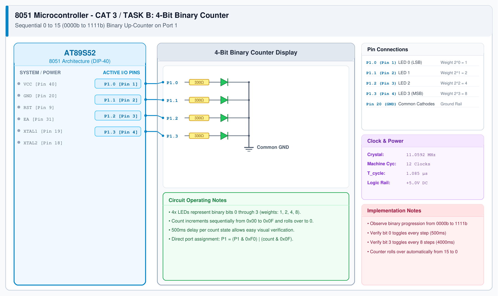

# EXPERIMENT DETAILS

**EXP:** CONTINUOUS ASSESSMENT 3

**DATE:** 11/08/2026

**NAME OF EXP:** Multi-Bit Binary Accumulator Display

**HARDWARE SETUP / PLATFORM:** AT89S52 MCU, 4x Green LEDs, 4x 330 Ohm Resistors, 1x Tactile Switch on P3.2, 11.0592 MHz Oscillator

---

## TASK3B : 4-Bit Binary Up-Counter with Push-Button Event Incrementing

### 1. Circuit Diagram

Port 1 pins P1.0, P1.1, P1.2, and P1.3 connect to four LEDs representing bits 0 through 3 (LSB to MSB) of a binary nibble. Tactile button is tied to P3.2 with an internal/external pull-up, closing to GND upon user activation.



---

### 2. Core Logic / Pseudocode / Code Base

**Working Principle & Operational Theory:**
Binary counting maps an internal 8-bit accumulator variable to physical output pins. To increment reliably on user switch interaction, contact bounce (mechanical vibration of metal switch reeds lasting 5 to 20 ms) must be filtered. The firmware employs software debounce: upon detecting a LOW transition on P3.2, a 20 ms delay is executed before re-verifying the state. If still LOW, the 4-bit counter variable is incremented (modulo 16) and masked onto Port 1.

**Pseudocode:**
```text
1. Initialize counter = 0, write 0 to P1 lower nibble.
2. Configure P3.2 as digital input.
3. Main Loop:
     a. Check if P3.2 == 0.
     b. If pressed, delay 20 ms for contact debounce.
     c. Re-sample P3.2; if confirmed pressed:
          counter = (counter + 1) & 0x0F;
          P1 = (P1 & 0xF0) | counter;
          while(P3.2 == 0); // wait for key release
          delay 20 ms for release debounce.
```

**Code Structure / Key Registers:**
- **Primary Registers / APIs:** P1 (0x90, lower nibble P1.0-P1.3), P3.2 (0xB2, switch input latch).
- **Clock / Timing Configurations:** Hardware clock tree and prescalers calibrated to theoretical operational parameters.

---

### 3. Inference

Demonstrated debounced event detection and binary visualization. The 4 LEDs accurately display sequential binary values from 0000_2 to 1111_2 (0 to 15 decimal) with automatic rollover.

> **Hardware Validation Note:** Verification status: `[CONFIRM ON BOARD/SIMULATION]: Depress button incrementally to verify monotonic binary sequence from 0x0 to 0xF without false bouncing.`.
