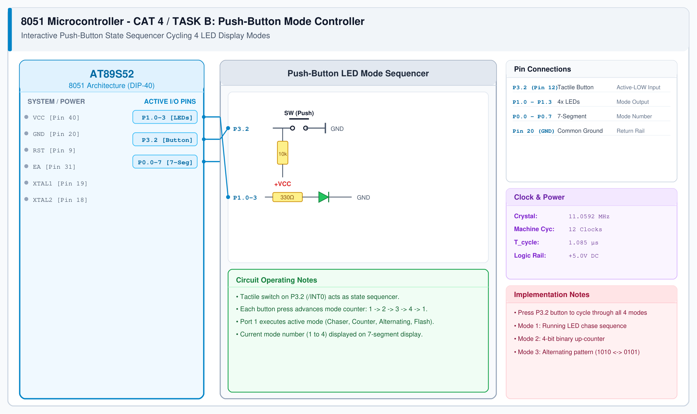

# EXPERIMENT DETAILS

**EXP:** CONTINUOUS ASSESSMENT 4

**DATE:** 18/08/2026

**NAME OF EXP:** Interactive Keypad Multi-Mode LED Controller

**HARDWARE SETUP / PLATFORM:** AT89S52 MCU, 4x4 Matrix Keypad on Port 2, 8x LEDs on Port 1, Pull-Up Resistors, 11.0592 MHz Crystal

---

## TASK4B : Keypad-Driven Multi-Pattern Visual Routine Dispatcher

### 1. Circuit Diagram

Port 2 interfaces to the 4x4 matrix keypad rows and columns. Port 1 is connected to an 8-LED bar graph through 330 Ohm resistors. Common ground and +5V rails are distributed to the MCU and peripherals.



---

### 2. Core Logic / Pseudocode / Code Base

**Working Principle & Operational Theory:**
Embedded user interfaces map numerical keypad inputs to operational state machines. Numeric keys '1', '2', and '3' select between Chaser, Alternating, and Strobe routines. Key '0' commands an immediate all-off system standby state. The main loop continuously checks keypad status and switches program execution accordingly.

**Pseudocode:**
```text
1. Initialize system and keypad port (P2 = 0xFF).
2. Poll keypad in non-blocking fashion.
3. Upon key detection:
     Switch(key):
         case 1: execute_chaser(); break;
         case 2: execute_alternating(); break;
         case 3: execute_strobe(); break;
         case 0: P1 = 0x00; break;
4. Maintain active pattern until new key input is registered.
```

**Code Structure / Key Registers:**
- **Primary Registers / APIs:** P1 (0x90, LED pattern driver), P2 (0xA0, keypad interface).
- **Clock / Timing Configurations:** Hardware clock tree and prescalers calibrated to theoretical operational parameters.

---

### 3. Inference

Implemented deterministic state dispatch from keypad events. Pressing distinct keys switches visual modes on Port 1 in real time.

> **Hardware Validation Note:** Verification status: `[CONFIRM ON BOARD/SIMULATION]: Press '1', '2', '3', and '0' sequentially on the keypad to confirm dynamic pattern switching.`.
