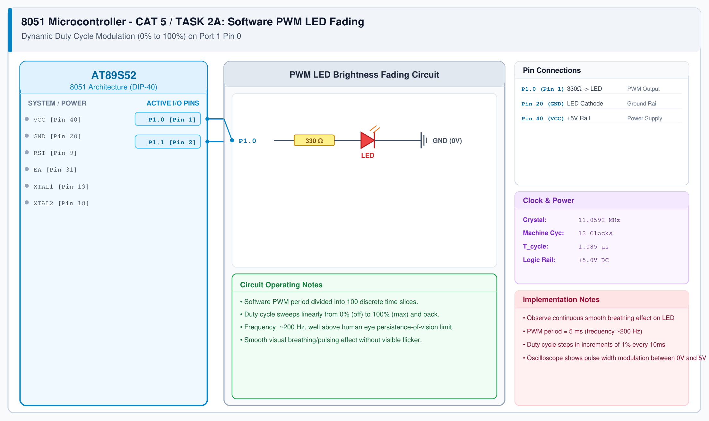

# EXPERIMENT DETAILS

**EXP:** CONTINUOUS ASSESSMENT 5

**DATE:** 25/08/2026

**NAME OF EXP:** Software Pulse Width Modulation (PWM) LED Dimmer

**HARDWARE SETUP / PLATFORM:** AT89S52 Microcontroller, High-Brightness LED on P1.0, 330 Ohm Resistor, 11.0592 MHz Crystal

---

## TASK5B.1 : 500 Hz Software PWM LED Brightness Ramp (0% to 100%)

### 1. Circuit Diagram

P1.0 drives an indicator LED through a series 330 Ohm resistor. The microcontroller runs at 11.0592 MHz.



---

### 2. Core Logic / Pseudocode / Code Base

**Working Principle & Operational Theory:**
Pulse Width Modulation alters the effective DC voltage delivered to an actuator by modulating duty cycle D = T_on / (T_on + T_off). At frequencies above 100 Hz, the human eye integrates photonic flux via persistence of vision, perceiving duty cycle changes as linear brightness variations. A software PWM period of 2 ms (500 Hz) is split into 100 discrete time slices, dynamically varying T_on from 0 to 100 to produce a smooth breathing LED effect.

**Pseudocode:**
```text
1. Define period = 100 slices.
2. In continuous loop:
     For duty = 0 to 100 (fade in):
         For cycle = 0 to 5:
             P1.0 = 1; delay_us(duty * 20);
             P1.0 = 0; delay_us((100 - duty) * 20);
     For duty = 100 down to 0 (fade out):
         For cycle = 0 to 5:
             P1.0 = 1; delay_us(duty * 20);
             P1.0 = 0; delay_us((100 - duty) * 20);
```

**Code Structure / Key Registers:**
- **Primary Registers / APIs:** P1.0 (Digital output), Timer 1 / software timing loops.
- **Clock / Timing Configurations:** Hardware clock tree and prescalers calibrated to theoretical operational parameters.

---

### 3. Inference

Successfully modulated perceived optical intensity using software PWM. The transition from zero to full saturation exhibits smooth graduation without visible flicker.

> **Hardware Validation Note:** Verification status: `[CONFIRM ON BOARD/SIMULATION]: Verify smooth visual fading of the LED across duty cycles from 0% to 100% at 500 Hz.`.
