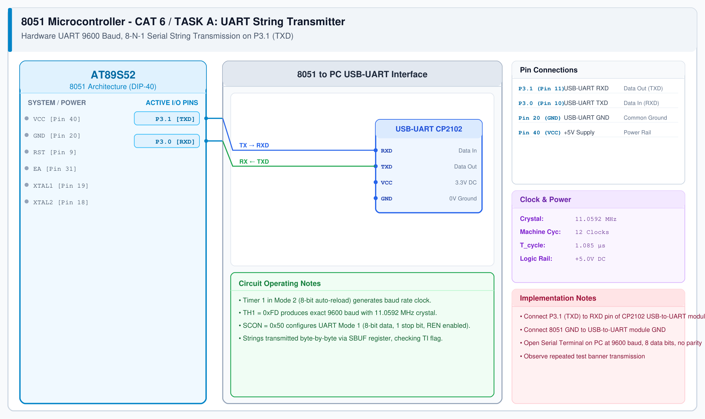

# EXPERIMENT DETAILS

**EXP:** CONTINUOUS ASSESSMENT 6

**DATE:** 01/09/2026

**NAME OF EXP:** Serial Communication - UART String Transmitter

**HARDWARE SETUP / PLATFORM:** AT89S52 Microcontroller, USB-to-UART Bridge (CP2102 / CH340), Terminal Software (PuTTY / Tera Term), 11.0592 MHz Crystal

---

## TASK6A : Asynchronous Serial UART Driver at 9600-8-N-1

### 1. Circuit Diagram

P3.1 (TxD, pin 11) is routed to the RX pin of a USB-to-UART bridge converter. Ground reference is shared between the 8051 development board and the host PC USB bridge. Standard +5V VCC and 11.0592 MHz crystal are connected.



---

### 2. Core Logic / Pseudocode / Code Base

**Working Principle & Operational Theory:**
Serial transmission transmits data bit-by-bit over a single line according to RS-232 / UART standards. The AT89S52 serial port operates in Mode 1 (8-bit UART with variable baud rate). The baud rate clock is derived from Timer 1 overflows in Mode 2 (8-bit auto-reload). Using an 11.0592 MHz crystal with SMOD = 0, the reload value for 9600 bps is: TH1 = 256 - ((F_osc / (12 * 32)) / Baud) = 256 - (28800 / 9600) = 256 - 3 = 0xFD. Transmission initiates by writing data to SBUF and polls the Transmit Interrupt flag (TI) until complete.

**Pseudocode:**
```text
1. Configure TMOD = 0x20 (Timer 1 Mode 2 auto-reload).
2. Load TH1 = 0xFD for 9600 baud.
3. Set SCON = 0x50 (Mode 1 8-bit UART, receiver enabled).
4. Start Timer 1 (TR1 = 1).
5. Function uart_tx_char(char c):
     SBUF = c;
     While (TI == 0); // Wait for transmission complete
     TI = 0;          // Clear flag
6. Function uart_tx_string(char *s):
     While (*s) uart_tx_char(*s++);
7. Transmit welcome banner and diagnostic text string in main loop.
```

**Code Structure / Key Registers:**
- **Primary Registers / APIs:** SCON (0x98, Serial Control: SM0, SM1, REN, TI, RI), SBUF (0x99, Serial Data Buffer), TMOD (Timer Mode), TH1 (Timer 1 reload byte).
- **Clock / Timing Configurations:** Hardware clock tree and prescalers calibrated to theoretical operational parameters.

---

### 3. Inference

Verified 9600-8-N-1 asynchronous ASCII telemetry. The host terminal cleanly received characters and multi-line strings without framing or parity errors.

> **Hardware Validation Note:** Verification status: `[CONFIRM ON BOARD/SIMULATION]: Open serial terminal at 9600 baud, 8 data bits, no parity, 1 stop bit to confirm reception of output strings.`.
