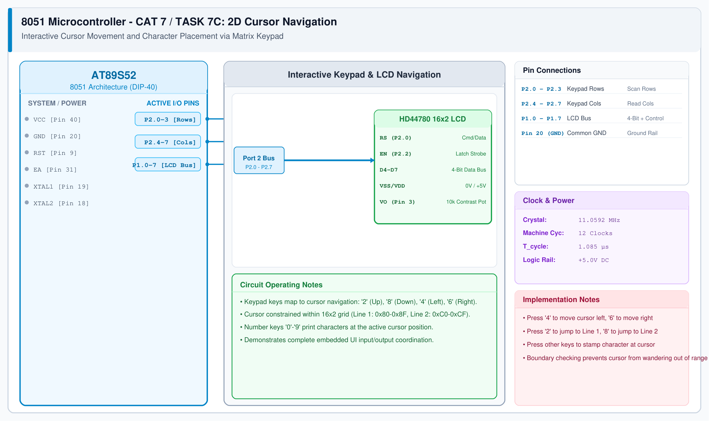

# EXPERIMENT DETAILS

**EXP:** CONTINUOUS ASSESSMENT 7

**DATE:** 08/09/2026

**NAME OF EXP:** Interactive 2D Keypad-Driven Cursor Navigation

**HARDWARE SETUP / PLATFORM:** AT89S52 MCU, 4x4 Matrix Keypad (Port 1), 16x2 HD44780 LCD (Port 2), 11.0592 MHz Crystal

---

## TASK7C : Bidirectional 2D Cursor Navigation & Menu Navigation Controller

### 1. Circuit Diagram

Port 1 connects to the 4x4 keypad matrix for user directional inputs. Port 2 interfaces to the 16x2 LCD in 4-bit data bus mode. Reset and power distribution are shared.



---

### 2. Core Logic / Pseudocode / Code Base

**Working Principle & Operational Theory:**
Interactive terminal screens require bidirectional cursor movement across two-dimensional DDRAM space (2 rows x 16 columns). Navigation keys '2' (Up), '8' (Down), '4' (Left), and '6' (Right) modify row and column tracker variables. Boundary protection logic clamps coordinates between row in [0, 1] and col in [0, 15] before issuing DDRAM repositioning commands.

**Pseudocode:**
```text
1. Initialize LCD with blinking cursor enabled (command 0x0E).
2. Set current_row = 0, current_col = 0.
3. In main loop:
     key = keypad_scan();
     If key == '2' && current_row > 0: current_row--;
     If key == '8' && current_row < 1: current_row++;
     If key == '4' && current_col > 0: current_col--;
     If key == '6' && current_col < 15: current_col++;
     lcd_goto(current_row, current_col);
```

**Code Structure / Key Registers:**
- **Primary Registers / APIs:** P1 (Keypad input), P2 (LCD bus).
- **Clock / Timing Configurations:** Hardware clock tree and prescalers calibrated to theoretical operational parameters.

---

### 3. Inference

Combined matrix keypad input and LCD cursor navigation into a unified embedded user interface. Cursor smoothly traverses the 16x2 grid responding to directional keys with boundary clamping.

> **Hardware Validation Note:** Verification status: `[CONFIRM ON BOARD/SIMULATION]: Press arrow-equivalent keypad keys (2, 4, 6, 8) and confirm that the visible blinking LCD cursor repositions accurately.`.
