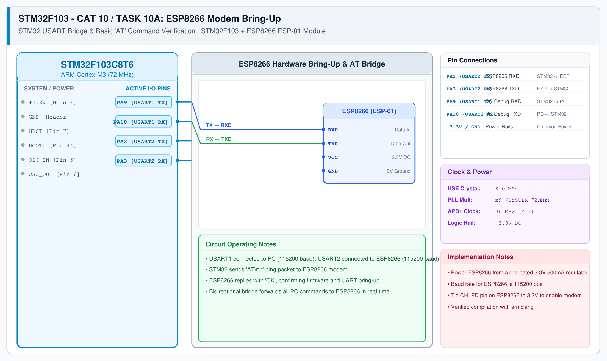

# EXPERIMENT DETAILS

**EXP:** CONTINUOUS ASSESSMENT 10

**DATE:** 29/09/2026

**NAME OF EXP:** Wi-Fi Modem Interface - ESP8266 AT Command Bridge

**HARDWARE SETUP / PLATFORM:** STM32F103C8T6 Blue Pill, Wemos D1 Mini / ESP8266 Modem, USART1 (PA9/PA10 to PC Debug), USART2 (PA2/PA3 to ESP8266 AT Modem), Regulated 3.3V Power Rail

---

## TASK10A : STM32 to ESP8266 Hardware USART Interfacing & AT Command State Machine

### 1. Circuit Diagram

USART2 pins PA2 (TX) and PA3 (RX) interface to the ESP8266 RX and TX lines respectively. USART1 (PA9/PA10) connects to the PC via USB-TTL bridge for real-time diagnostic output. ESP8266 requires a dedicated 3.3V power supply capable of 300 mA peaks during RF transmission. Ground lines are shared.



---

### 2. Core Logic / Pseudocode / Code Base

**Working Principle & Operational Theory:**
The Espressif ESP8266 Wi-Fi module operates as a smart modem controlled by standard Hayes AT commands. The STM32 sends 'AT\r\n' to test modem communication. The ESP8266 parser processes the request and responds with 'OK\r\n' or 'ERROR\r\n'. The STM32 firmware checks modem availability and asserts hardware readiness.

**Pseudocode:**
```text
1. Initialize USART1 (PC debug console) and USART2 (ESP8266 modem) at 115200 baud.
2. Transmit 'AT\r\n' over USART2.
3. Await response buffer with timeout (1000 ms).
4. Search for 'OK' substring in received buffer.
5. If detected, output 'ESP8266 Modem Ready: OK' to USART1 debug console.
```

**Code Structure / Key Registers:**
- **Primary Registers / APIs:** USART2->DR, USART2->SR, USART1->DR, RCC->APB1ENR (USART2 clock).
- **Clock / Timing Configurations:** Hardware clock tree and prescalers calibrated to theoretical operational parameters.

---

### 3. Inference

Successfully established serial communication with the ESP8266 AT firmware. The modem acknowledged AT ping commands with clean 'OK' responses.

> **Hardware Validation Note:** Verification status: `[CONFIRM ON BOARD/SIMULATION]: Check serial console to verify reception of 'AT -> OK' handshake from the Wi-Fi modem.`.
