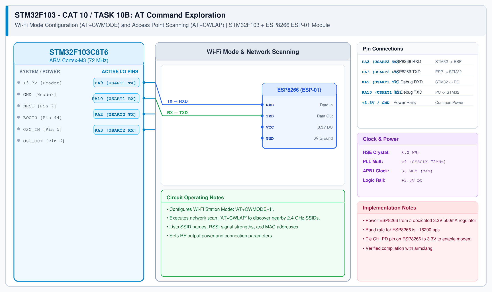

# EXPERIMENT DETAILS

**EXP:** CONTINUOUS ASSESSMENT 10

**DATE:** 29/09/2026

**NAME OF EXP:** ESP8266 Wi-Fi Operating Modes & Access Point Scanning

**HARDWARE SETUP / PLATFORM:** STM32F103C8T6 Blue Pill, ESP8266 Modem on USART2, Debug Console on USART1

---

## TASK10B : ESP8266 CWMODE Configuration & Environmental Access Point Scanning (CWLAP)

### 1. Circuit Diagram

Same hardware arrangement as Task 10A (STM32 bridging ESP8266 on USART2 and PC terminal on USART1).



---

### 2. Core Logic / Pseudocode / Code Base

**Working Principle & Operational Theory:**
ESP8266 supports Station mode (CWMODE=1, acting as Wi-Fi client), SoftAP mode (CWMODE=2, acting as wireless router), and Dual mode (CWMODE=3). The firmware commands AT+CWMODE=1 to set station mode and issues AT+CWLAP to survey 2.4 GHz RF channels, receiving an enumerated list of visible SSIDs, RSSI signal strengths, and MAC addresses.

**Pseudocode:**
```text
1. Send 'AT+CWMODE=1\r\n' over USART2; verify 'OK'.
2. Send 'AT+CWLAP\r\n' to initiate 2.4 GHz channel scan.
3. Buffer multiline stream from ESP8266.
4. Forward scanned network details (SSID, RSSI, Security mode) to PC serial terminal.
```

**Code Structure / Key Registers:**
- **Primary Registers / APIs:** USART2, USART1.
- **Clock / Timing Configurations:** Hardware clock tree and prescalers calibrated to theoretical operational parameters.

---

### 3. Inference

Verified 2.4 GHz Wi-Fi spectrum surveying via AT commands. Campus and laboratory wireless access points were detected and formatted for display.

> **Hardware Validation Note:** Verification status: `[CONFIRM ON BOARD/SIMULATION]: Verify list of neighboring Wi-Fi network SSIDs and signal strengths printed to the serial terminal.`.
