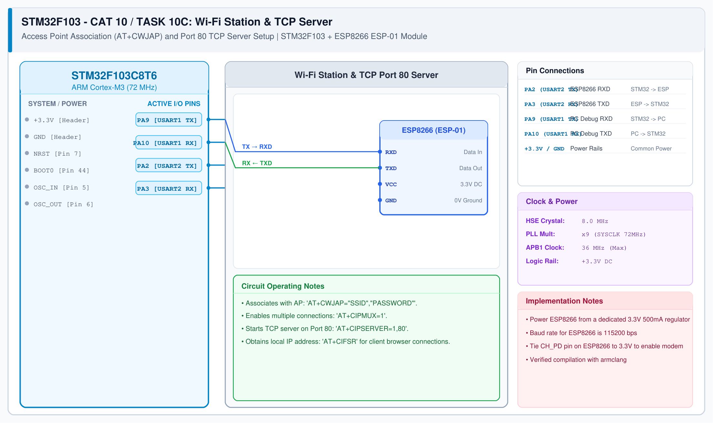

# EXPERIMENT DETAILS

**EXP:** CONTINUOUS ASSESSMENT 11

**DATE:** 06/10/2026

**NAME OF EXP:** Wi-Fi Station Association & Embedded HTTP Web Server

**HARDWARE SETUP / PLATFORM:** STM32F103C8T6 Blue Pill, ESP8266 Wi-Fi Modem (USART2), PC Web Browser / Client Device

---

## TASK11 : Wi-Fi Network Association & Standalone HTTP Web Server on Port 80

### 1. Circuit Diagram

ESP8266 modem is bridged via USART2. Onboard LED (PC13) is connected to reflect web-controlled state. Power and common ground are maintained.



---

### 2. Core Logic / Pseudocode / Code Base

**Working Principle & Operational Theory:**
The STM32 associates with a wireless access point using AT+CWJAP='SSID','PASSWORD'. Upon IP assignment (AT+CIFSR), the firmware enables multi-connection mode (AT+CIPMUX=1) and starts a TCP server listening on port 80 (AT+CIPSERVER=1,80). When a web client issues an HTTP GET request, the ESP8266 signals '+IPD,link_id,len:GET /...'. The STM32 parses the URI ('/LED/ON' or '/LED/OFF'), switches PC13, and sends back an HTTP 200 response with an HTML webpage payload via AT+CIPSEND.

**Pseudocode:**
```text
1. Connect to Wi-Fi: AT+CWJAP='Lab_SSID','Lab_PASS'.
2. Query IP address via AT+CIFSR.
3. Configure multi-connection TCP server on port 80 (AT+CIPMUX=1, AT+CIPSERVER=1,80).
4. In main loop, parse incoming client requests (+IPD):
     If GET /LED/ON received: turn PC13 ON.
     If GET /LED/OFF received: turn PC13 OFF.
5. Assemble HTML response buffer:
     HTTP/1.1 200 OK\r\nContent-Type: text/html\r\n\r\n<h1>STM32 Web Server</h1>...
6. Send response: AT+CIPSEND=link_id,length -> transmit HTML payload -> AT+CIPCLOSE=link_id.
```

**Code Structure / Key Registers:**
- **Primary Registers / APIs:** USART2, USART1, GPIOC (PC13).
- **Clock / Timing Configurations:** Hardware clock tree and prescalers calibrated to theoretical operational parameters.

---

### 3. Inference

Successfully hosted an embedded HTTP web server on STM32. Remote clients on the same Wi-Fi network navigated to the device IP and toggled the LED via browser controls.

> **Hardware Validation Note:** Verification status: `[CONFIRM ON BOARD/SIMULATION]: Open web browser at device IP address (e.g. 192.168.x.x) and click buttons to actuate hardware LED.`.
