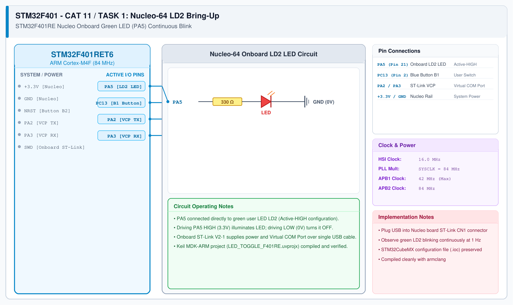

# EXPERIMENT DETAILS

**EXP:** CONTINUOUS ASSESSMENT 12

**DATE:** 13/10/2026

**NAME OF EXP:** ARM Cortex-M4 NUCLEO-F401RE Hardware Platform Bring-Up

**HARDWARE SETUP / PLATFORM:** STM32 Nucleo-F401RE (ARM Cortex-M4 with FPU @ 84 MHz), Onboard User LED LD2 (PA5, Active-HIGH), ST-LINK V2.1 Virtual COM Port (USART2 on PA2/PA3)

---

## TASK12A : STM32 Nucleo-F401RE 84 MHz Hardware Bring-Up & Onboard LD2 LED Controller

### 1. Circuit Diagram

The STM32F401RET6 MCU resides on the ST Nucleo-64 board. Onboard Green LED LD2 is connected to GPIO pin PA5 (active-HIGH). The board is powered and programmed through an integrated ST-LINK/V2-1 USB debugger. Clocking utilizes the internal 16 MHz High-Speed Internal (HSI) RC oscillator multiplied by the PLL to achieve SYSCLK = 84 MHz (AHB = 84 MHz, APB1 = 42 MHz, APB2 = 84 MHz).



---

### 2. Core Logic / Pseudocode / Code Base

**Working Principle & Operational Theory:**
ARM Cortex-M4 includes high-performance DSP extensions and single-precision Floating Point Unit (FPU). System bring-up configures Flash latency (2 wait states at 84 MHz) and sets up the PLL prescalers (PLL_M=16, PLL_N=336, PLL_P=4). Pin PA5 is initialized in Output Push-Pull mode. HAL_GPIO_TogglePin() with HAL_Delay(500) synthesizes a calibrated 1 Hz flashing rate.

**Pseudocode:**
```text
1. HAL_Init();
2. SystemClock_Config(): Configure HSI -> PLL to generate SYSCLK = 84 MHz.
3. __HAL_RCC_GPIOA_CLK_ENABLE();
4. Configure PA5 as GPIO_MODE_OUTPUT_PP, GPIO_PULLUP, GPIO_SPEED_FREQ_LOW.
5. In main loop:
     HAL_GPIO_TogglePin(GPIOA, GPIO_PIN_5);
     HAL_Delay(500);
```

**Code Structure / Key Registers:**
- **Primary Registers / APIs:** GPIOA->MODER (PA5 mode), RCC->CR, RCC->PLLCFGR, FLASH->ACR (Flash latency).
- **Clock / Timing Configurations:** Hardware clock tree and prescalers calibrated to theoretical operational parameters.

---

### 3. Inference

Verified 84 MHz Cortex-M4 platform bring-up. The onboard Green LED LD2 pulses with exact 500 ms high/low intervals governed by SysTick.

> **Hardware Validation Note:** Verification status: `[CONFIRM ON BOARD/SIMULATION]: Flash hex file to Nucleo-F401RE and verify LD2 toggling steadily at 1.00 Hz.`.
