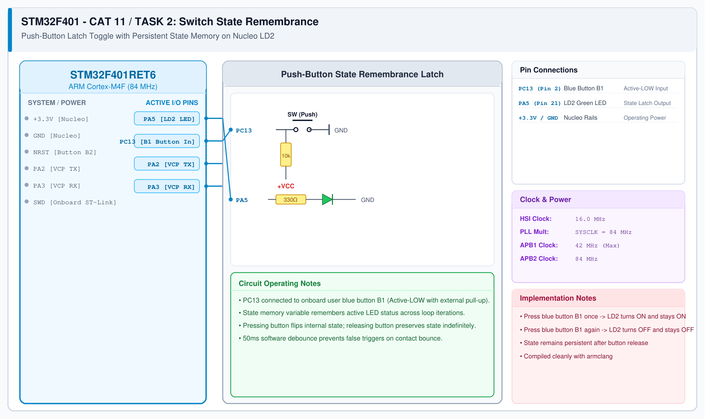

# EXPERIMENT DETAILS

**EXP:** CONTINUOUS ASSESSMENT 12

**DATE:** 13/10/2026

**NAME OF EXP:** NUCLEO-F401RE User Button Debounce & Memory State Controller

**HARDWARE SETUP / PLATFORM:** STM32 Nucleo-F401RE, Blue User Button B1 (PC13, Active-LOW), Green LED LD2 (PA5)

---

## TASK12B : User Switch (B1, PC13) Interrupt/Polling with State Retention on LD2 (PA5)

### 1. Circuit Diagram

Blue tactile button B1 is tied to PC13 (pulls to GND when pressed). Green LED LD2 is connected to PA5.



---

### 2. Core Logic / Pseudocode / Code Base

**Working Principle & Operational Theory:**
Handling user inputs on the Nucleo board requires managing the active-LOW switch topology on PC13. The firmware implements a state-retention latch: whenever a debounced falling-edge event is verified on PC13, an internal boolean flag is inverted. The hardware driver writes this state to PA5, allowing the user to turn LD2 ON with one tap and OFF with a subsequent tap.

**Pseudocode:**
```text
1. Configure PA5 as output (LD2) and PC13 as input (B1 button).
2. Loop continuously:
     If HAL_GPIO_ReadPin(GPIOC, GPIO_PIN_13) == GPIO_PIN_RESET:
         HAL_Delay(25); // Debounce delay
         If HAL_GPIO_ReadPin(GPIOC, GPIO_PIN_13) == GPIO_PIN_RESET:
             system_state = !system_state;
             HAL_GPIO_WritePin(GPIOA, GPIO_PIN_5, system_state ? GPIO_PIN_SET : GPIO_PIN_RESET);
             While(HAL_GPIO_ReadPin(GPIOC, GPIO_PIN_13) == GPIO_PIN_RESET); // Await release
             HAL_Delay(25);
```

**Code Structure / Key Registers:**
- **Primary Registers / APIs:** GPIOC->IDR, GPIOA->BSRR, SysTick.
- **Clock / Timing Configurations:** Hardware clock tree and prescalers calibrated to theoretical operational parameters.

---

### 3. Inference

Implemented contact debouncing and state retention on the Nucleo-F401RE platform. Successive button presses reliably switch and hold LED states.

> **Hardware Validation Note:** Verification status: `[CONFIRM ON BOARD/SIMULATION]: Press blue button B1 to latch LD2 ON; press again to latch LD2 OFF.`.
