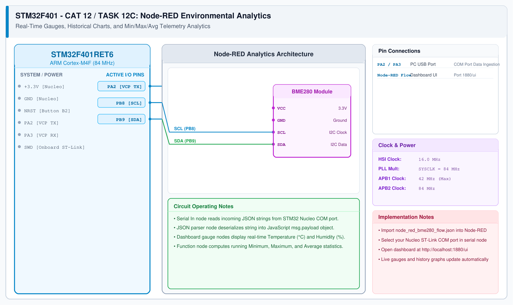

# EXPERIMENT DETAILS

**EXP:** CONTINUOUS ASSESSMENT 13

**DATE:** 20/10/2026

**NAME OF EXP:** Live HTTP Telemetry Service & Node-RED Dashboard Ingestion

**HARDWARE SETUP / PLATFORM:** STM32 Nucleo-F401RE, BME280 Sensor (I2C1), ESP8266 Modem (USART1), Node-RED Runtime on Host PC

---

## TASK13C : Embedded HTTP REST Telemetry Server & Node-RED Visual Dashboard

### 1. Circuit Diagram

BME280 is wired to I2C1 (PB8/PB9). ESP8266 Wi-Fi modem is wired to USART1 (PA9/PA10). Node-RED runtime operates on the local network at localhost:1880.



---

### 2. Core Logic / Pseudocode / Code Base

**Working Principle & Operational Theory:**
The STM32 hosts an HTTP server on port 80 via the ESP8266 modem. Node-RED periodically triggers an HTTP GET request to the device IP (/weather). The STM32 responds with the serialized JSON sensor telemetry. Node-RED parses the payload and dynamically updates real-time radial gauges, charts, and numeric cards on its web dashboard.

**Pseudocode:**
```text
1. Establish Wi-Fi connection and start TCP server on port 80 via ESP8266.
2. When incoming HTTP GET /weather arrives:
     Sample BME280 data over I2C1.
     Assemble HTTP response with application/json header and JSON payload.
     Send response via AT+CIPSEND and close socket.
3. In Node-RED:
     Deploy HTTP Request node polling STM32 IP every 5 seconds.
     Connect JSON parser to Dashboard UI gauge nodes.
```

**Code Structure / Key Registers:**
- **Primary Registers / APIs:** I2C1, USART1, USART2.
- **Clock / Timing Configurations:** Hardware clock tree and prescalers calibrated to theoretical operational parameters.

---

### 3. Inference

Constructed an end-to-end IoT REST telemetry pipeline. Node-RED successfully polled the STM32 web server and visualized live ambient climate metrics.

> **Hardware Validation Note:** Verification status: `[CONFIRM ON BOARD/SIMULATION]: Open Node-RED dashboard at http://localhost:1880/ui to verify real-time gauge updates.`.
